<a href="https://www.mirastacklabs.ai"><picture><source media="(prefers-color-scheme: dark)" srcset="docs/public/brand/mirastack-labs-lockup-dark.svg"></picture></a>

platformcosmo &middot; built by the engineering team at [MIRASTACK LABS](https://www.mirastacklabs.ai).

# platformcosmo

**Prompt in, animated isometric architecture diagram out.**

A Claude Code plugin and CLI that turns a sentence, a whiteboard photo or a PDF manual into a living
2.5D diagram: requests flow, servers fail, traffic fails over, racks slide open, parts explode and
snap back. One self-contained SVG, no JavaScript, works anywhere an image does.

[](https://www.npmjs.com/package/platformcosmo)
[](https://www.npmjs.com/package/@platformcosmo/core)
[](https://github.com/mirastacklabs-ai/platformcosmo/actions/workflows/ci.yml)
[](LICENSE)
[](https://nodejs.org)
[](#quick-start)
[](https://platformcosmo.io)

<p align="center">
  
</p>

> ```
> /platformcosmo:diagram A load balancer sending user traffic round-robin to three app servers
> backed by a database, with health checks and a failover step when one server goes down
> ```
>
> A prompt like this gets you a diagram like the one above: Claude writes a short JSON spec
> ([this one](examples/load-balancing.cosmo.json)) and the engine does the rest.

## Why it is different

- 🧠 **Claude writes the spec, code draws the picture.** Claude only produces a small JSON spec.
  Layout, routing, depth sorting and animation are deterministic code: the same spec always gives
  byte-identical SVG, so diagrams diff and review like code.
- 🎞️ **Animated, with zero JavaScript.** Particles flow along edges, steps change states and zoom
  the camera. It plays in ``, inline and `<object>`, respects reduced motion, and follows the
  viewer's light or dark mode.
- 📷 **From what you already have.** Attach a screenshot, an exported diagram, a whiteboard photo, a
  manual figure, a board plan or a PDF, and it is redrawn as a validated spec.
- 🏢 **Cloud to copper.** Cloud, Kubernetes, AI and data pipelines, then all the way down: data-center
  halls, racks, servers, boards and single parts, with close-ups that zoom from the hall to the heat sink.
- 🔒 **Offline and safe.** The only network access is the icon download you ask for. Icons are
  sanitized, text is escaped, and the output has no external references.

## Gallery

Every image here is the real, animated output of `pcosmo build`, from the spec in [`examples/`](examples).
Copy one with `pcosmo examples copy <name>`.

<table>
  <tr>
    <td width="50%" valign="top"><b>RAG pipeline</b><br></td>
    <td width="50%" valign="top"><b>GPU inference cluster</b><br></td>
  </tr>
  <tr>
    <td valign="top"><b>Kubernetes deployment</b><br></td>
    <td valign="top"><b>CDN and cache</b><br></td>
  </tr>
  <tr>
    <td valign="top"><b>Data-center hall</b><br></td>
    <td valign="top"><b>From the hall to the heat sink</b><br></td>
  </tr>
  <tr>
    <td valign="top"><b>Brick rover, built and exploded</b><br></td>
    <td valign="top"><b>AWS three-tier web app</b><br></td>
  </tr>
</table>

More on [platformcosmo.io/gallery](https://platformcosmo.io/gallery).

## Quick start

You need Node.js >= 22.12 on your `PATH`.

### Claude Code plugin

Inside [Claude Code](https://code.claude.com):

```
/plugin marketplace add mirastacklabs-ai/platformcosmo
/plugin install platformcosmo@platformcosmo
```

Or from a shell: `claude plugin marketplace add mirastacklabs-ai/platformcosmo` and
`claude plugin install platformcosmo@platformcosmo`. The plugin ships a self-contained `pcosmo` CLI;
nothing else is installed.

Then ask for a diagram:

```
/platformcosmo:diagram a RAG pipeline with a vector DB and a guardrail
```

Claude writes `<name>.cosmo.json`, validates it, fixes any errors, builds it and reports the output
paths. Re-export any time, in any format or theme:

```
/platformcosmo:export <name>.cosmo.json --gif --interactive --theme blueprint
```

### npm CLI

The same CLI is on npm, published with provenance:

```sh
npx platformcosmo init my.cosmo.json
npx platformcosmo build my.cosmo.json
```

or `npm i -D platformcosmo` and run `pcosmo`. The engine is
[`@platformcosmo/core`](https://www.npmjs.com/package/@platformcosmo/core).

## Outputs and looks

| Output                  | Flag             |
| ----------------------- | ---------------- |
| Animated, looping SVG   | (default)        |
| First-frame SVG         | `--static`       |
| One SVG per step        | `--steps`        |
| Play / Pause / Step SVG | `--interactive`  |
| PNG                     | `--png`          |
| GIF, MP4 (with ffmpeg)  | `--gif`, `--mp4` |

Themes: `light` and `dark` (the MIRASTACK LABS brand look), `blueprint` (blue drafting) and `mono`
(greyscale), or your own theme JSON with `--theme <file>`.

## Icons

Bundled: platformcosmo, Lucide, Kubernetes and a permissive subset of Simple Icons (276 icons). Add
more on your own machine:

```
/platformcosmo:icons add aws
/platformcosmo:icons add https://github.com/feathericons/feather/tree/main/icons
```

Provider packs (AWS, Azure, Google Cloud) are downloaded from the official source on your machine and
never redistributed. Azure requires accepting its terms.

## Docs

Guides, the spec format, the CLI reference and the full gallery: **[platformcosmo.io](https://platformcosmo.io)**.
The site sources are in [`docs/`](docs).

## Development

Everything runs in containers; nothing is installed on the host:

```sh
scripts/pc install
scripts/pc run ci
```

See [CONTRIBUTING.md](CONTRIBUTING.md), [docs/PLAN.md](docs/PLAN.md) and
[DECISIONS.md](DECISIONS.md).

## Credits

Created and open-sourced by [MIRASTACK LABS](https://www.mirastacklabs.ai). Built with Claude Code;
the AI tokens were sponsored by MIRASTACK LABS.

## License

Apache-2.0, Copyright 2026 MIRASTACK LABS PRIVATE LIMITED. See [LICENSE](LICENSE), [NOTICE](NOTICE),
[LICENSES/](LICENSES) and [plugin/THIRD_PARTY_NOTICES.md](plugin/THIRD_PARTY_NOTICES.md).

## Trademarks

AWS, Azure, Google Cloud, Kubernetes and other product names, logos and marks belong to
their respective owners. platformcosmo is not affiliated with or endorsed by them. Provider
icon packs are not redistributed; users fetch them from the official source.
